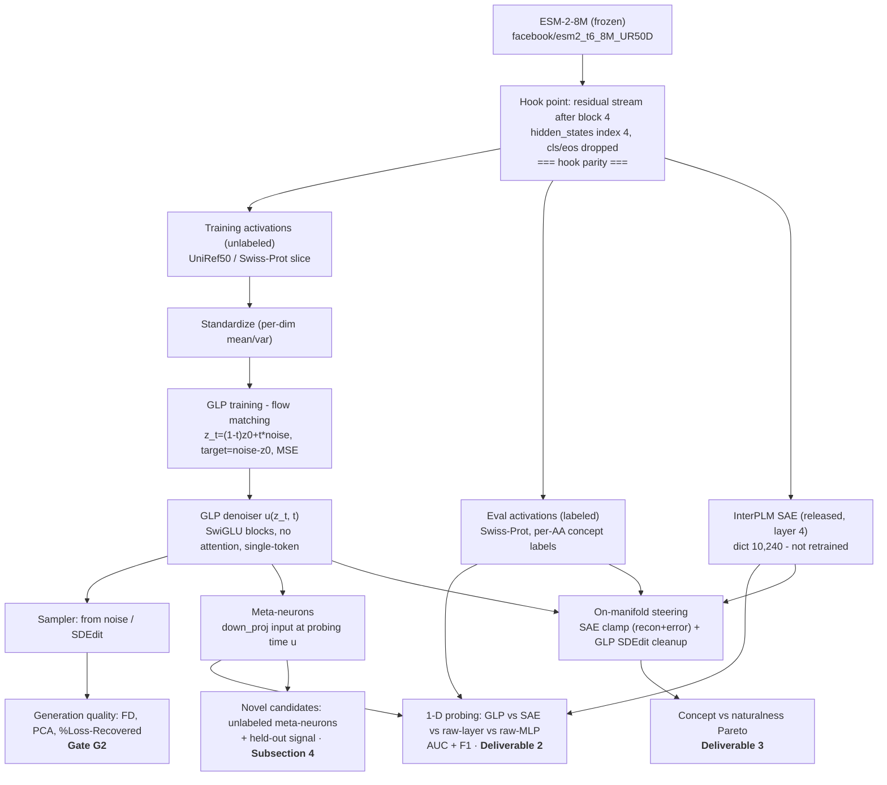

# Generative Latent Prior for Protein Language Models — Implementation Plan

**Target venue:** *Interpretability for Discovery* workshop, NeurIPS 2026 (non-archival). Deadline: 5 weeks.
**Execution model:** Built and run primarily via Claude Code. Local Apple-Silicon proof-of-concept first, then a compute cluster (assume 1× H100; multi-GPU only if time allows).
**Conventions:** Sections marked `⚠ DECISION` need human sign-off; `⚠ RISK` carries go/no-go weight; `⚠ FAIRNESS` marks reviewer-attack surfaces. Claims have been verified against the InterPLM and GLP clones — see `docs/INTERPLM_MAP.md` for `file:line` citations.

---


## 0. One-paragraph summary

We port the **Generative Latent Prior (GLP)** — a diffusion "meta-model" of neural activations (Luo et al., 2026) — from LLM activations to **protein language model (PLM) activations**, reusing the **InterPLM** (Simon & Zou, *Nature Methods* 2024) SAE + Swiss-Prot annotation pipeline as our validated substrate. GLP learns the *distribution* of ESM-2 residual-stream activations with no linearity/sparsity assumptions. We test two claims a protein biologist can act on: (1) GLP's internal "meta-neurons" isolate biological concepts at least as well as InterPLM's SAE features, measured by 1-D probing against Swiss-Prot concepts; and (2) using GLP as an on-manifold prior makes SAE-based concept steering produce **more natural proteins** at matched concept strength. A small subsection surfaces meta-neurons that map to *no* known annotation but show a **held-out** signal (causal steering effect or cross-family consistency) — candidate motifs for domain follow-up.

**InterPLM SAE weights are released on HuggingFace** (`Elana/InterPLM-esm2-8m`, layers 1–6; `Elana/InterPLM-esm2-650m`, layers 1,9,18,24,30,33), loadable via `interplm.sae.inference.load_sae_from_hf`. We do **not** retrain SAEs.

**Pipeline (project logic).** Everything hangs off one frozen hook point — the ESM-2-8M residual stream after block 4 — which feeds both the unlabeled GLP training data and the labeled Swiss-Prot eval data, and is exactly what the released SAE saw (hook parity). The trained GLP denoiser then drives all three deliverables.




---


## 1. Thesis and framing (workshop alignment)

**Thesis.** *A generative meta-model of ESM-2 activations provides a nonlinear encoder whose units isolate biological concepts at least as cleanly as sparse dictionaries, and — used as a manifold prior — yields concept-steered proteins that are more natural than naive steering.*

**Why this is a *discovery* paper, not a methods port.** The workshop reframes interpretability as a tool for *discovery*, not explanation. Our discovery-aligned outputs are:

- **A nonlinear alternative to the linear-dictionary assumption.** SAEs decompose activations as a *sparse linear* combination of dictionary atoms. GLP imposes no such assumption. **Claim we can defend:** GLP's meta-neurons empirically isolate concepts the SAE fragments or under-recovers (measured by probing). **Claim we do NOT assert without a dedicated test:** that a probing win *proves* the SAE cannot represent the structure. See §6.5.1 for the optional falsification test that would license the stronger nonlinearity claim.
- **Steered proteins a wet-lab could screen.** On-manifold steering that improves naturalness (and, Tier-2, foldability via pLDDT) produces concrete, domain-testable artifacts.
- **Novel candidate motifs.** Meta-neurons with consistent activation but no Swiss-Prot label, tied to a *held-out* signal, are hypotheses for annotation.

**Framing guardrail (reviewer defense).** We frame GLP as **complementary** to InterPLM SAEs, not a competitor that must "win.", but this will be determined by the results we get. "SAE surfaces concept A; GLP's nonlinear encoder recovers concept B more cleanly" is a *result*, not a failure. The probing comparison is the quantitative backbone, **not** the headline, and the paper does not hinge on beating the SAE on average AUC.

---


## 2. Background locked from the two papers (ground truth for implementation)


### 2.1 GLP (Luo et al., 2026) — the method we port

- **Objective — flow matching.** Forward: `z_t = (1 − t)·z0 + t·ε`, `t ∈ [0,1]`. Reverse from `z1 ~ N(0,I)`: `z_{t'} = z_t + û·(t' − t)`. Train denoiser `û_θ(z_t, t)` to predict target velocity `u = ε − z0` with **MSE loss**. Unconditional.
- **Architecture.** Stack of **SwiGLU MLP blocks with residual connections**. **No attention** (single-token modeling, like SAEs). **Norm is LayerNorm, not RMSNorm** (verified in the released code). Timestep conditioning is the only diffusion-specific piece and is now known exactly from the release: a `time_proj = Linear(d_model→d_mlp)` applied to the time embedding **multiplies the SwiGLU gate pre-activation** — `SiLU(gate_proj(x)·time_proj(t_emb))·up_proj(x)`. This is a **plain multiplicative** modulation: **no** `(1+γ)` **scale, no** `β` **bias, and the** `up` **path is not modulated** (i.e. not the standard FiLM parameterisation the earlier plan versions assumed). Source: `generative_latent_prior/glp/denoiser.py:111,119-124`.
- **Width rule (critical for generation quality).** `model_width = 2 × activation_dim`; gated-MLP **expansion factor = 2× over model width** ⇒ MLP inner = `4 × activation_dim`. GLP found sufficient width relative to input essential (Li et al., 2024).
- **Data pipeline.** Same activations used for SAEs: residual stream at one intermediate layer, all token positions except BOS. **Producer–consumer**: producer caches into a fixed-size buffer flushed on consumption. Consumer uses **mixed-precision**. Standardize activations to zero-mean/unit-var before diffusion; restore after.
- **Their hyperparameters.** 1 epoch over 1B activations, batch 4096, lr 5e-5, cosine, warmup 0.01. Middlemost layer (Llama1B L7 / Llama8B L15). Sizes 0.5B–3.3B params (3–24 blocks) at d=2048. Single A100-80GB; longest run 5.6 days. **These are d=2048 settings — starting points for us, not gospel (see §6.2).**
- **Available-feature counts (Table 12) confirm the meta-neuron formula.** Llama8B GLP (6 blocks, d=4096 ⇒ inner 16384): 6×16384 = 98,304 meta-neurons ✓. Llama1B 24-block (inner 8192): 24×8192 = 196,608 ✓. So **meta-neuron count = n_blocks × MLP_inner**.
- **Generation-quality metrics.** **Frechet Distance (FD)** between 50k generated (from noise, 1000 steps) vs. real activations; lower bound = FD(train, val). Reference magnitudes: Llama1B lower-bound 0.22, SAE-recon 1.99, GLP 0.53–0.68; Llama8B lower-bound 2.60, SAE-recon 6.91, GLP 5.93. **Note: GLP beats SAE but does not reach the lower bound** — see §6.4. **PCA overlap** (top-2 PCs); converges ~20 steps. **Delta LM Loss** = increase in source-model loss from injecting reconstructed activations (GLP adapts this by interpolating a real activation with noise at `t_start=0.5`, 20 steps).
- **On-manifold steering (SDEdit analog).** `acts_edit = acts + α·w`; standardize; `acts_noisy = (1−t_start)·acts_edit + t_start·noise`; reverse-sample `t_start`→0; de-standardize. **Bigger** `t_start` **= stronger correction, weaker edit-fidelity.** Config: `t_start=0.5`, `num_steps=20`, `α = r·‖a‖₂`, helpful regime `r ≥ 1`. Pushes the concept–fluency Pareto frontier outward on sentiment/SAE-feature/persona steering.
- **Probing (Section 5).** "Meta-neurons" = the **post-gating gated-MLP neuron value at each block, i.e. the input to** `down_proj` — `φᵢ(z) = SiLU(gate_proj(x)·time_proj(t_emb))·up_proj(x)` (NOT the bare gate pre-activation; per GLP's footnote this is the gated MLP neuron of Choi et al. 2024). **The value includes the** `time_proj(t_emb)` **factor** and is therefore a function of the probing time (this refines earlier plan versions, which wrote `SiLU(gate)·up` and dropped the time factor). Source: `generative_latent_prior/glp/script_probe.py:128,104` hooks `denoiser.model.layers.{i}.down_proj` input. Read from one forward pass with input noised at a chosen `u` (schedule fraction; **released default** `u=0.9` ⇒ lightly-noised/near-clean; NOT the plan's earlier `t=0.1/0.5`). Probes are run **on the last-token activation** (see §6.5, H4 — this needs a protein-specific decision). Per concept: filter to top-k=512 candidates on train, fit 1-D logistic regression (L-BFGS 1000 iters, L2, 5-fold CV over {1e-5…1e0}), select best by **val AUC**, report **test AUC**. GLP beats SAE, raw layer output, raw MLP neuron across 113 tasks.


### 2.2 InterPLM (Simon & Zou, 2024) — our substrate

- **Model.** ESM-2-8M (`facebook/esm2_t6_8M_UR50D`): 6 transformer blocks, **d=320**, `intermediate_size=1280` (FFN, GELU), 20 heads, **rotary** position embeddings, `vocab_size=33`, `mask_token_id=32`, `pad_token_id=1` (from config.json; `d=320` corroborated by `interplm/embedders/esm.py:25`; the other fields are re-verified on first model download in W1). Second option: ESM-2-650M (`facebook/esm2_t33_650M_UR50D`), **d=1280**, 33 layers. **InterPLM uses the canonical** `EsmForMaskedLM`**/**`EsmModel`**; do not use the NVIDIA** `nv_esm` **repackaging** (different class, would break hook parity).
- **Released SAEs (verified on HF, Jan 2025).** `Elana/InterPLM-esm2-8m` layers 1–6; `Elana/InterPLM-esm2-650m` layers 1,9,18,24,30,33. Both: expansion 32× ⇒ **dictionary 10,240**. Load via `load_sae_from_hf(plm_model="esm2-8m", plm_layer=4)` or `hf_hub_download(repo_id="Elana/InterPLM-esm2-8m", filename="layer_4/ae_normalized.pt")` → `load_model(...)`. **(The paper text's "10,420" is a typo; 320×32 = 10,240 is correct and matches the HF cards.)**
- **SAE hook.** Residual stream **after transformer blocks 1–6**, **excluding** `<cls>` **and** `<eos>`. Primary analyses use **layer 4**.
- **Embedding helper (reuse this) — API corrected.** There is **no** `interplm.esm.embed` **module**. The real embedder is the class `interplm.embedders.esm.ESM` (factory `interplm.embedders.get_embedder("esm", model_name=...)`); `model_name` is a **constructor** arg. Methods: `embed_single_sequence(sequence, layer)` (`esm.py:242`) and `extract_embeddings_multiple_layers(sequences, layers, batch_size, shuffle)` (`esm.py:116`). Both **already drop** `<cls>`**/**`<eos>`**/pad** and return `(n_tokens, d)` (`esm.py:181-186`), so our wrapper **must not re-strip** and hook parity is **exact** (not "up to the cls/eos drop"). **We call these to guarantee hook parity — we do not reimplement extraction.** (See §6.1, R5.)
- **SAE training data (for reference only; we don't retrain).** 5M UniRef50 sequences, sharded per 1,000 proteins, tokens shuffled within shards.
- **Feature normalization.** Each feature scaled to [0,1] by max activation over a 50k Swiss-Prot scan (`ae_normalized.pt` already encodes this).
- **Swiss-Prot eval set.** Reviewed UniProtKB proteins **that have an AlphaFoldDB structure** (the pipeline drops rows without one — `extract_annotations.py:151`), length **≤ 1022** (CLS+EOS ⇒ 1024 tokens; `extract_annotations.py:256`), split by **shard ranges** (not a fixed 25k/25k — `prepare_eval_set.py:15-22`). Protein-level annotations → **per-amino-acid binary labels**, domain relationships preserved (each domain instance gets a distinct integer index in `aa_concepts.npz`). **Concept frequency filter (corrected): kept if** `>25` **domains OR** `>1,500` **AAs** — the real `make_eval_subset` defaults (`prepare_eval_set.py:21-22`); the "10" cited in earlier versions is `min_required_instances` (a *subcategory-inclusion* knob, default 100), a different parameter. **Field names:** `ft_act_site`, `ft_binding`, `ft_disulfid`, `ft_helix`, `ft_turn`, `ft_strand`, `ft_coiled`, `ft_carbohyd`, `ft_transit`, … are the UniProt **REST download field IDs** (README:163); after `extract_annotations` the **materialized concept columns are human-readable display names + subcategory expansions** (e.g. `Active site_<note>`, `Binding site_<ligand>`, `Helix`, `Beta strand`, `Disulfide bond`) read from `uniprotkb_aa_concepts_columns.txt` — read that file, never hardcode `ft_`*. ℹ️ Because every eval protein has an AFDB accession, the §6.7 biophysical candidate signal is cheaper than earlier billed.
- `⚠` **Concept-count provenance (versions disagree — do NOT hardcode):** the v1 preprint (in our context) reports **433 concepts evaluated / 143 aligned**; the bioRxiv v2 / Nature Methods version reports a hierarchical categorization over **258 concepts**. The paper also exists as arXiv:2412.12101. These are different numbers from different versions. **Claude Code must read the actual released concept set from the repo/dashboard, not trust any hardcoded count from this plan.** The concept-selection procedure (§7) operates on whatever set the repo materializes, so it is robust to which version is used.
- **InterPLM metric.** Domain-adjusted F1: **precision per amino acid, recall per domain**. Threshold swept {0, 0.15, 0.5, 0.6, 0.8}, best-F1 kept.
- **Steering (NNsight).** Decompose ESM embedding into **SAE reconstruction + error**; **clamp** target feature to a value (fraction of max activation); recombine; continue forward pass; read logits/softmax. Demonstrated on **periodic-glycine features** (`f/4616, f/4970, f/10003`) with `MGPP<mask>PP`, steering only the unmasked G, measuring P(G) at the masked position.
- **Auto-interp.** Claude generates feature descriptions from ~40 proteins spanning activation bins + Swiss-Prot metadata; validated by predicting held-out activations (median Pearson r=0.72).


### 2.3 The one genuine methodological gap

GLP's fluency = "free-run generate text, LLM-judge it." **ESM-2 is a bidirectional masked encoder — there is no autoregressive generation loop.** We replace "fluency" with encoder-native naturalness metrics (§6.6). This is the only genuinely *new* methodology; everything else is a port. We are explicit in the paper that pseudo-perplexity is an imperfect naturalness proxy, which is the scientific motivation for the Tier-2 foldability metric — not merely a nicety.

---


## 3. Scope, deliverables, and non-goals

**Primary deliverables (must ship):**

1. Trained GLP on ESM-2-8M layer-4 activations passing FD / PCA / %Loss-Recovered sanity checks.
2. **1-D probing comparison**: GLP meta-neurons vs. InterPLM SAE features vs. raw ESM MLP neurons vs. raw layer output, on Swiss-Prot concepts — AUC (GLP protocol) **and** domain-adjusted F1 (InterPLM protocol), on a **pre-registered concept set** (§7).

**Secondary deliverable (value-add — ship if W2 gate passes):**
3. **On-manifold steering**: InterPLM SAE-feature steering + GLP SDEdit cleanup; glycine testbed then broader; concept-vs-naturalness Pareto.

**Subsection (small, ship if time):**
4. **Novel candidates**: meta-neurons with consistent activation, no Swiss-Prot label, tied to a held-out signal.

**Stretch (only if W1–W3 clean):**
5. **ESM-2-650M scaling point** (released SAEs — now cheap on the SAE side).
6. **Tier-2 steering metric**: ESMFold pLDDT / foldability.
7. **Mini scaling curve** (3 GLP sizes): diffusion-loss vs probe-AUC — the cheapest way to echo GLP's central "loss predicts utility" result (§6.7).

**Non-goals (state in paper):** from-scratch SAE research; multi-token/cross-position GLP; multi-layer GLP; conditional GLP; wet-lab validation. Future work.

---


## 4. `⚠ DECISION` register (resolved defaults — veto if wrong)


| #   | Decision           | Default                                                                           | Rationale                                                                                                                                                                                                  |
| --- | ------------------ | --------------------------------------------------------------------------------- | ---------------------------------------------------------------------------------------------------------------------------------------------------------------------------------------------------------- |
| D1  | Spine model        | **ESM-2-8M, layer 4, d=320**                                                      | Tiny GLP (~15M params), Mac-trainable, H100-fast. Layer 4 = InterPLM's primary analysis layer, best-characterized SAE.                                                                                     |
| D2  | Hook point         | **Residual after block 4** (`hidden_states[4]`), via `interplm.embedders.esm.ESM` | Byte-identical to what the released SAE saw (R5); API corrected in §2.2.                                                                                                                                   |
| D3  | 650M               | **Stretch scaling point; hook a released-SAE layer (e.g. layer 18 or 24)**        | SAE side now cheap (released weights at layers 1,9,18,24,30,33); cost is the wider GLP + embedding extraction.                                                                                             |
| D4  | ESMFold/pLDDT      | **Tier-2, cluster-only, feasibility-gated**                                       | HF `EsmForProteinFolding` **vendors** openfold utils (no separate `pip install openfold`, no `nvcc` compile) BUT is not openfold-free and needs **16–24 GB GPU mem**. Primary steering metric is pure-ESM. |
| D5  | Probing metric     | **AUC (headline) + F1 (secondary)**                                               | AUC = faithful GLP port; F1 = InterPLM-native.                                                                                                                                                             |
| D6  | SAE weights        | **Download released HF weights**                                                  | Verified available; retraining unnecessary.                                                                                                                                                                |
| D7  | Discovery emphasis | **Probing+steering spine; novel candidates = 1 subsection**                       | Per PI direction.                                                                                                                                                                                          |
| D8  | Mac PoC            | **End-to-end parity smoke test**                                                  | Cluster is a config swap.                                                                                                                                                                                  |
| D9  | Probing `u`        | **Select on val, report on test** over a `u` grid (e.g. {0.1,0.5,0.9})            | Closes a fairness hole (R8). Probing time lives in `u` (schedule fraction, released default 0.9), not `t=0.1/0.5`.                                                                                         |


---


## 5. Repository architecture

Repo `glp-prot/` — the `glp_plm/` package plus the two reference repos as **git submodules** (`InterPLM/`, `generative_latent_prior/`). We **reuse InterPLM's code** (SAE loading, embedding extraction, Swiss-Prot annotation, NNsight steering) by putting it on `sys.path` — not forking, and not `pip install -e` (see `SETUP.md` / `docs/INTERPLM_MAP.md`). Legend below: unmarked = implemented; `(Wn)` = planned for that week; `(stub)` = placeholder CLI.

```
glp-prot/
├── CLAUDE.md · README.md · SETUP.md · requirements.txt · pyproject.toml
├── docs/
│   ├── PLAN.md                       # this spec
│   ├── INTERPLM_MAP.md               # reuse map for the two clones (file:line) + gotchas
│   └── papers/                       # reference PDFs (gitignored)
├── InterPLM/                         # git submodule (ElanaPearl/InterPLM) — reused via sys.path
├── generative_latent_prior/         # git submodule (g-luo/…) — GLP reference code
├── configs/
│   ├── poc_mac.yaml                  # MPS/CPU, fp32, ~2M acts, 2-block GLP
│   ├── local_clean.yaml              # MPS, fp32, 10M acts, 6-block GLP — CANONICAL run
│   │                                 #   (eval proteins excluded from training)
│   ├── esm8m_h100.yaml               # full spine: cuda, bf16, streaming
│   └── esm650m_h100.yaml             # (stretch, NOT YET WRITTEN) 650M scaling point
├── glp_plm/
│   ├── config.py                     # single dataclass config schema (YAML)
│   ├── data/
│   │   ├── activation_extractor.py   # thin wrapper over interplm.embedders.esm.ESM (hook parity)
│   │   ├── activation_store.py       # fp16 memmap shards + scaler (Mac precache)
│   │   ├── swissprot_labels.py       # UniProt REST fetch + InterPLM annotation → per-AA labels
│   │   └── producer_consumer.py      # (W2) streaming buffer for the cluster — stub
│   ├── model/
│   │   ├── swiglu_block.py           # LayerNorm + SwiGLU + multiplicative t-gate; exposes meta-neuron
│   │   ├── glp.py                    # GLPDenoiser û(z_t,t); in/out proj; meta_neurons()
│   │   └── timestep_embed.py         # sinusoidal + MLP embedding of t
│   ├── diffusion/
│   │   ├── flow_matching.py          # z_t=(1-t)z0+tε, target ε−z0, MSE
│   │   ├── sampler.py                # reverse Euler; sample / sample_on_manifold (SDEdit)
│   │   └── scaler.py                 # per-dim {mean,var} standardize/destandardize
│   ├── train/
│   │   ├── trainer.py                # loop, cosine+warmup, grad clip, metric logging
│   │   └── scaling_sweep.py          # (stretch) 3-size scaling curve
│   ├── eval/
│   │   ├── frechet.py                # FD between two activation sets (+ lower bound)
│   │   ├── pca_overlap.py            # top-2 PCA, real vs generated
│   │   ├── loss_recovered.py         # (W2) %Loss-Recovered (adapt interplm.train.fidelity)
│   │   ├── meta_neurons.py           # down_proj-input meta-neurons at probing u (u = 1 - t)
│   │   ├── probing_1d.py             # GLP protocol: top-512 filter→1D LR→val AUC→test AUC
│   │   ├── baselines.py              # SAE / raw-layer / raw-MLP (ESM FFN hook) banks
│   │   ├── probing_f1.py             # InterPLM domain-adjusted F1, rate-matched two-sided
│   │   ├── concept_selection.py      # pre-registered concept picker (§7)
│   │   ├── steering.py               # (W4) SAE clamp + GLP SDEdit cleanup via NNsight
│   │   ├── naturalness.py            # (W4) pseudo-perplexity, AA-dist shift
│   │   └── esmfold_plddt.py          # (W4, optional) Tier-2 foldability
│   ├── experiments/
│   │   ├── metrics.py                # RunLogger: metric artifacts (source of truth)
│   │   ├── style.py                  # shared matplotlib style + validated palette
│   │   ├── figures.py                # figure registry (each declares its inputs)
│   │   └── report.py                 # make_report + compare_runs
│   └── utils/                        # device, seeds
├── scripts/                         # one CLI per phase (§11); _bootstrap.py puts repo+InterPLM on path
│   ├── download_interplm_saes.py · extract_activations.py · build_swissprot_eval.py
│   ├── train_glp.py · eval_generation.py · make_report.py
│   └── freeze_concepts.py · run_probing.py · run_steering.py · auto_interp_metaneurons.py   # (W3/W4) stubs
├── tests/                           # test_hook_parity.py · test_flow_matching_roundtrip.py · conftest.py
└── runs/                            # per-run outputs: metrics/ + figures/ + checkpoints (gitignored)
```

**Figures.** Compute writes metric artifacts to `runs/<name>/metrics/`; `experiments`
renders figures to `runs/<name>/figures/` from a registry (each figure declares the
artifacts it needs), so `make_report` produces whatever the current phase enables and new
figures are one-function additions — no runner changes.

**Interface contract:** every phase is one script + one `config.yaml`. `poc_mac.yaml → esm8m_h100.yaml` changes only `device`, scale knobs, buffer mode, precision — no code changes (D8 parity).

**Hook-parity test (shipped,** `tests/test_hook_parity.py`**):** assert that `activation_extractor` output for a fixed sequence **equals** `ESM(model_name="facebook/esm2_t6_8M_UR50D").embed_single_sequence(seq, layer=4)` **exactly** (the embedder already drops cls/eos, so no "up to" caveat). This is the single most important guard in the repo (R5). It skips cleanly until InterPLM + ESM-2-8M weights are present, then must pass.

---


## 6. Detailed component specs


### 6.1 Data — activation extraction

**Reuse InterPLM's embedder.** `activation_extractor.py` wraps `interplm.embedders.esm.ESM` (via `get_embedder`); it does not touch ESM directly. It (a) calls `embed_single_sequence(seq, L)` / `extract_embeddings_multiple_layers(...)` at layer L, (b) returns `[n_tokens, d]` **as-is** — the helper has **already** dropped `<cls>`/`<eos>`/pad (`esm.py:181-186`), so the wrapper adds no processing. This guarantees the GLP training distribution == the SAE training distribution.

**HF hidden-state indexing note (prevents off-by-one) — confirmed.** With `output_hidden_states=True`, `hidden_states[0]` = input embeddings, `hidden_states[1..6]` = outputs of blocks 1..6. InterPLM "layer 4" = `hidden_states[4]` (verified in `esm.py:179` and independently in `intervention.py:52-53`). The InterPLM helper already handles this; our wrapper matches its convention, verified by the hook-parity test.

**Two stores:**

- **Training store** (unlabeled): UniRef50 subset, for GLP training. **Must exclude every protein in the eval store** — see the risk register; the naive Swiss-Prot queries overlap ~98%.
- **Eval store** (labeled): InterPLM's 50k Swiss-Prot proteins, 25k/25k val/test, per-AA concept labels, for probing + steering. Reuse InterPLM's split.

**Format:** `fp16`, `[N, d]`. Eval store adds `(protein_id, position, {concept: 0/1})`.

**Standardization:** per-dim mean/std over a large training-store sample, persisted as `scaler.pt`; applied before diffusion, inverted after sampling; reused for eval/steering.

**Activation budget** `⚠ DECISION`**:**

- Mac PoC: **2M activations** (~1.3 GB fp16). **Source:** use a small Swiss-Prot slice — README notes Swiss-Prot works for this — **no UniRef50 download for the PoC**. Note the shipped 1k subset `data/uniprotkb/swissprot_dense_annot_1k_subset.tsv.gz` is **gitignored and absent from the clone**; fetch it from upstream or pull a small reviewed+AFDB Swiss-Prot slice via the README REST query.
- Cluster spine: **start 50M → 100M → 300M**, watch FD plateau. d=320 manifold ≪ Llama d=2048, so we expect convergence well below GLP's 1B. **Empirically determined, not assumed.**
- 300M fp16 ≈ 190 GB → **streaming producer-consumer on cluster**; pre-caching is Mac-only. (100M ≈ 64 GB fits most scratch disks as a fallback.)


### 6.2 Model — GLP ported to d=320


| Symbol       | Rule           | ESM-2-8M         | ESM-2-650M     |
| ------------ | -------------- | ---------------- | -------------- |
| `d`          | —              | 320              | 1280           |
| `width`      | 2·d            | 640              | 2560           |
| MLP inner    | 2·width = 4·d  | 1280             | 5120           |
| `n_blocks`   | scan           | PoC 2; spine 4→6 | 6              |
| ≈ params     | —              | ~15–25M*         | ~230–320M*     |
| meta-neurons | n_blocks·inner | 7,680 (6 blk)    | 30,720 (6 blk) |


- **Block (matches the released code):** `x → LayerNorm → SwiGLU(t) → +residual`, where `SwiGLU(t) = down_proj(SiLU(gate_proj(x)·time_proj(t_emb)) · up_proj(x))`. **Norm is LayerNorm, not RMSNorm** (D3). **Timestep conditioning (D4):** the exact scheme is now known from the release — a `time_proj = Linear(d_model→d_mlp)` on the time embedding **multiplies the gate pre-activation**; **no** `(1+γ)` **scale, no** `β` **bias, up path unmodulated**. The earlier "standard-FiLM extrapolation" caveat is **resolved** — implement the released scheme directly. Source: `generative_latent_prior/glp/denoiser.py:111,119-124`.
- **In/out projections:** `d→width` in, `width→d` out (velocity prediction).
- **Normalizer (D7):** persist `{mean, var}` and use `(x−mean)/√var` (matches the release's `rep_statistics.pt` layout so GLP-published stats can be loaded); `std=√var`.
- `⚠` **Hyperparameters are d=2048 defaults — re-tune for d=320.** Batch 4096 / lr 5e-5 / cosine / warmup 0.01 are starting points. At d=320 expect to sweep lr ∈ {1e-4, 5e-5, 2e-5} and possibly larger batch. Treat GLP's numbers as priors, not settings.

*Param counts are **approximate** — my SwiGLU-only arithmetic under-predicts GLP's published counts by ~40% (their Llama8B-GLP is 3.4B vs. ~2.4B from gate/up/down alone; timestep/FiLM/projection params make up the rest). **The training script must print the true parameter count**; do not trust the estimate.

**Unit test (ship before training):** flow-matching round-trip — a model returning exact `u = ε − z0` must reconstruct `z0` from `z1` under the sampler to tolerance.

### 6.3 Diffusion + sampling

- **Loss:** `z0`~~store,~~ `ε`N(0,I), `t`~U(0,1); `z_t=(1−t)z0+tε`; `MSE(û, ε−z0)`.
- **Sampler:** `linspace(t_start, 0, num_steps)`; Euler `z ← z + dt·û`. `t_start=1` gen-from-noise; `t_start=0.5` SDEdit/loss-recovered. **Note:** the released reference integrates via diffusers `FlowMatchEulerDiscreteScheduler` (where σ plays the role of `t`); our own Euler is mathematically **exact for the constant-velocity case** (basis of the round-trip test). To reproduce GLP's *published FD magnitudes*, match their scheduler's σ-spacing (W2 only; non-blocking).
- **Steps:** 1000 for final FD; 20 for steering cleanup & PCA sanity.


### 6.4 Generation-quality eval (the W2 gate)

- **FD:** Frechet distance, 50k generated (noise, 1000 steps) vs 50k held-out real. **Match GLP's sampling: one token per document** (H3), not 50k arbitrary tokens, so magnitudes are comparable to their Table 1. Report three anchors: (i) **lower bound** = FD(train-sample, val-sample); (ii) **SAE-reconstruction FD** (InterPLM SAE reconstructs real activations — a *more favorable* setting than GLP's from-noise); (iii) GLP FD.
- `⚠` **Realistic gate (R9):** the defensible pass is **GLP FD < SAE-reconstruction FD**. "Approaching the lower bound" is *not* guaranteed — in GLP's own Llama8B, GLP (5.93) sits nearer the SAE (6.91) than the lower bound (2.60). We report the gap honestly, not aspirationally.
- **`⚠` FD is meaningless without its step count (measured).** On the 6-block/10M local run the FD ratio to the lower bound is **2.81× @20 steps, 1.98× @50, 1.74× @100, 1.59× @300, 1.55× @1000** — at low step counts FD reports *sampler error*, not model quality, and it saturates by ~300. The config therefore separates `sampler.num_steps` (20, steering/PCA) from `sampler.fd_num_steps` (1000, FD). Always quote FD with its step count.
- **PCA overlap:** top-2 PCs, real vs generated; expect convergence ~20 steps. *(PCA does converge fast; FD does not — see above.)*
- **% Loss Recovered (R4, primary reconstruction metric):** InterPLM-native. Inject GLP-"reconstructed" activations (real interpolated with noise at `t_start=0.5`, 20 steps) at layer L; recompute ESM **masked-LM cross-entropy** and report `%LR = (1 − (CE_recon − CE_orig)/(CE_zero − CE_orig))·100`. **Masking protocol (**`⚠` **confirm against InterPLM code, do not assume):** InterPLM's exact %LR CE definition for a masked LM isn't restated in the Methods we have; match their implementation. If unspecified, default to ESM's standard 15% MLM masking on a fixed held-out set, injecting reconstructed activations at all non-special positions and measuring CE on masked positions only — but treat this as a default to verify, not a fact. Compare GLP vs the released SAE (which reports 98–100% per layer). This equals GLP's "Delta LM Loss" up to framing — we report %LR because it's the metric the ESM-interp community reads.


### 6.5 Probing (Primary Deliverable 2)

- **Meta-neuron bank:** per eval activation, GLP forward at `u` (selected on val, reported on test — D9), collect the **post-gating gated-MLP neuron = input to** `down_proj` **=** `SiLU(gate_proj(x)·time_proj(t_emb))·up_proj(x)` at each block (H2; includes the time factor) → `[N, n_blocks·inner]` (8M/6-block: 7,680 candidates). Hooked as `denoiser.model.layers.{i}.down_proj` input (`script_probe.py:128`).
- **Baselines (R6, pinned):**
- **InterPLM SAE features:** 10,240, from released `ae_normalized.pt` at layer 4.
- **Raw layer output:** the residual stream at layer 4, d=320 (also GLP's/SAE's input).
- **Raw ESM MLP neuron:** ESM-2-8M's **FFN intermediate activation** at layer 4, d_ff = 1,280 (standard 4× FFN). Tap the FFN hidden pre-output-projection, matching GLP's "raw MLP neuron" baseline.
- `⚠` **H4 — probing position (port decision, NOT inherited blindly):** GLP probes the **last-token** activation because its concepts are sequence-level. Our Swiss-Prot concepts are **per-residue** (a residue is or isn't in a binding site). So we probe **per-amino-acid activations at annotated positions**, matching InterPLM's per-AA label granularity — we do **not** copy GLP's last-token choice, which would be wrong here. State this divergence explicitly in the paper.
- **AUC protocol (headline):** per concept — top-k=512 candidates on train, 1-D logistic regression per candidate (L-BFGS 1000 iters, L2, 5-fold CV over {1e-5…1e0}), select by **val AUC**, report **test AUC**; aggregate with 95% bootstrap CIs.
- **F1 protocol (secondary):** InterPLM domain-adjusted F1 (precision/AA, recall/domain), threshold sweep.
  - **`⚠ FAIRNESS` — rate-matched, two-sided operating points (approved deviation from D5).** InterPLM sweeps thresholds as a *fraction of each feature's max activation*, which presupposes sparse non-negative ReLU features. On dense signed activations that grid degenerates — measured on our eval set, `thr=0.0` fires on **56%** of residues and `thr=0.5` on **0.07%**, with nothing usable between — and 44% of values are negative, invisible to a one-sided `f > thr`. We instead choose each operating point by **activation rate** (per-feature quantile, top {0.05, 0.2, 1, 5}% of residues), applied identically to every method, and allow either **sign**. The F1 / recall-per-domain *definitions* are unchanged. The result is the same under both schemes, which is what makes it trustworthy. State the deviation in the paper.
  - **F1 is prevalence-sensitive**, so unlike AUC it is evaluated at natural prevalence on the full split (streamed), never on a balanced subsample.
- `⚠ FAIRNESS`**:** identical candidate budget (k=512) and train/val/test discipline across all four methods; report per-method candidate counts (GLP Table 12 analog); selection on train, evaluation on test, never peek. Report both the pre-registered headline set and the aggregate over *all* qualifying concepts.


#### 6.5.1 Optional falsification test for the nonlinearity claim (R2)

A probing-AUC win alone does **not** prove GLP captures structure the SAE cannot represent. If we want to make that stronger claim, run this: for a concept where GLP's best meta-neuron beats the best SAE feature, test whether the meta-neuron is well-approximated by *any linear function of the SAE feature dictionary* (fit linear map from SAE features → meta-neuron value; measure R²). **Low R² = the meta-neuron encodes something not in the SAE's linear span** → licenses "nonlinear structure the dictionary misses." **High R² = the win is repackaging, not new structure** → we retract the nonlinearity claim and keep only "cleaner isolation." Either outcome is honest and reportable. This is cheap and worth doing for 3–5 headline concepts.

### 6.6 Steering (Secondary Deliverable 3)

- **Base = InterPLM's NNsight recipe:** decompose layer-L embedding into SAE reconstruction + error; clamp target feature; recombine; continue forward pass; read logits.
- **GLP add-on:** after recombine, SDEdit-clean the (single-token) recombined activation (`scaler → noise to t_start=0.5 → denoise 20 steps → de-scaler`) before continuing. **GLP cleans per-position activation vectors independently** (it models single-token activations); when multiple positions are steered, each is cleaned independently. State this explicitly to avoid the misreading that we jointly denoise a whole-sequence tensor.
- **Testbed 1 (cheap, reproducible):** periodic-glycine features (`f/4616, f/4970, f/10003`) on `MGPP<mask>PP`; steer the unmasked G; measure P(G) at the masked position vs clamp strength. Reproduce InterPLM Fig 7, then add the GLP curve.
- **Testbed 2 (broader):** disulfide (`ft_disulfid`→Cys), helix (`ft_helix`), a few high-F1 features; steer at concept positions in natural Swiss-Prot sequences.
- **Metrics (encoder-native naturalness — R3, orthogonalized):**
- **Concept score:** increase in target-consistent AA probability, measured **only at target/masked positions**.
- **Naturalness score:** **pseudo-perplexity measured only at non-steered, non-adjacent positions** (mask-one-at-a-time NLL of true residues), capturing *collateral* damage to untouched context. The two axes are therefore measured on disjoint positions and are genuinely orthogonal.
- **Output:** concept-vs-naturalness **Pareto frontier** as clamp strength sweeps — the ESM analog of GLP Fig 5. Claim: GLP cleanup pushes the frontier out.
- **Honest caveat (in paper):** pPPL is an imperfect naturalness proxy; it can reward mere in-distribution-ness. This is precisely why Tier-2 foldability is the stronger axis.
- **Tier-2 (feasibility-gated):** iteratively fill masks to generate a steered sequence, fold with HF `EsmForProteinFolding`, report **pLDDT**. "GLP-cleaned steering yields more foldable proteins." `⚠` H1: the HF port vendors openfold utilities (no `nvcc`/separate openfold install) but needs **16–24 GB GPU memory** and is a genuinely heavy dependency — verified, not openfold-free. Batch folding accordingly.


### 6.7 Novel candidates (Subsection 4) — held-out signal fixed (R7)

- Auto-interpret meta-neurons via InterPLM's Claude pipeline (max-activating proteins + Swiss-Prot metadata → description; validate by predicting held-out activations).
- **Candidate = coherent, consistent activation + no Swiss-Prot label.**
- `⚠` **"Unannotated ≠ discovery" guard — primary held-out signal is structure-free:**

1. **Causal steering effect** (no structures needed): steering the candidate meta-neuron produces a consistent, interpretable shift in AA predictions.
2. **Cross-family consistency** (no structures needed): the candidate activates coherently across proteins from *different* Pfam families held out from selection.

- **Optional upgrade (needs structures) — cheaper than earlier billed:** correlation with a biophysical property (SASA, contact number, secondary-structure propensity) computed from **AlphaFold DB** structures for the max-activating UniProt entries. **Every eval protein already has an AFDB accession** (the annotation pipeline filters to AFDB-bearing proteins — `extract_annotations.py:151`), so no extra selection is needed; the cost is only the AFDB-fetch + DSSP/biotite dependency. Consider promoting from "only if W4 slack" to a light default.
- Report a small curated set, explicitly labeled as hypotheses.


### 6.7.1 Mini scaling curve (stretch, R11)

Train 3 GLP sizes (e.g., 2, 4, 6 blocks) on the 8M spine; plot **diffusion loss vs probe-AUC** and **diffusion loss vs steering-Pareto-area**. If the GLP phenomenon ports, these track — the cheapest possible echo of GLP's central scaling result at d=320. Non-blocking; strong if it lands.

---


## 7. `⚠ FAIRNESS` — pre-registered Swiss-Prot concept selection for the probing table

The single biggest cherry-picking risk is choosing concepts *after* seeing GLP's numbers. We pre-register the selection using **only InterPLM-validation-set statistics and the SAE's own val F1** — never any GLP output — freeze the list, then run all methods. `concept_selection.py` implements and dumps `frozen_concepts.json` (committed before probing runs).

**Selection procedure:**

1. **Candidate pool:** all Swiss-Prot concepts passing InterPLM's frequency filter — `>25` **domains OR** `>1,500` **AAs** (the real `make_eval_subset` defaults, `prepare_eval_set.py:21-22`; the earlier ">10 domains" conflated the different `min_required_instances` knob). Read the materialized concept set from `uniprotkb_aa_concepts_columns.txt` (display-name columns, not `ft_`*).
2. **Stability filter:** require ≥ 500 positive AA tokens in the **test** split (so per-concept AUC has tight CIs). Record positive prevalence per concept.
3. **Category stratification:** tag each concept into one of five biological buckets so the table spans biology, not one easy category:
  *Structural* — `ft_helix`, `ft_strand`, `ft_turn`, `ft_coiled`
   *Chemical/PTM* — `ft_disulfid`, `ft_carbohyd`, modified residues
   *Binding/catalytic* — `ft_act_site`, `ft_binding`
   *Topology/localization* — `ft_transmem`, `ft_intramem`, signal/transit
   *Domain/family motifs* — selected Pfam/Swiss-Prot domain concepts
4. **SAE-tractability spread:** compute each concept's SAE tractability from released weights. *(Implemented as best single-SAE-feature **val AUC** rather than val F1 — it preserves the property that matters (SAE-only, no GLP) and avoids the threshold sweep at selection time. State the substitution in the paper.)* Within each category, deliberately include concepts spanning the F1 range — some the SAE handles well (high F1) *and* some it struggles with (low F1). The low-F1-for-SAE concepts are where a nonlinear encoder could plausibly help; including them by rule (not by result) is what makes a GLP win credible rather than cherry-picked.
5. **Freeze the headline set:** **3 per category**, chosen to satisfy (2)–(4). Deterministic given the val statistics; seed and log the tie-breaks. *(Realized N depends on the eval set: on the 20k-protein local set only 2 `binding_catalytic` concepts qualify, so the frozen set is **14**, not 15.)*

**Reporting (three levels, so the headline is never a hand-picked subset):**

- **(a) Illustrative table** on the frozen concepts: test AUC (+F1) per method, per concept.
- **(b) The actual claim** — aggregate test AUC over **all** stability-passing concepts (the full pool, GLP's 113-task-average analog), with 95% bootstrap CIs.
- **(c) Per-category breakdown** — mean AUC per method per bucket, to show *where* each method wins (supports the "complementary" framing).

This structure means: even if a reviewer distrusts the frozen-concept table, (b) is the un-gameable number, and (c) turns a possible "GLP loses on average" into an informative result about which biology each encoder captures.

---


## 8. Compute profile


| Phase       | Hardware      | Model        | Acts               | GLP          | Precision             | Est. time                             |
| ----------- | ------------- | ------------ | ------------------ | ------------ | --------------------- | ------------------------------------- |
| PoC         | Mac (MPS/CPU) | ESM-2-8M     | ~2M (pre-cached)   | 2 blk, ~8M   | fp32 (MPS bf16 flaky) | ~10 min (measured)                    |
| **Local mid** | **Mac M4 16 GB** | **ESM-2-8M** | **10M (pre-cached, 6.4 GB)** | **6 blk, 21M** | **fp32** | **~12 min extract + ~20 min train (measured)** |
| Spine       | 1× H100       | ESM-2-8M     | 50→300M (streamed) | 4→6 blk      | bf16                  | hours→~1 day                          |
| Stretch     | 1× H100       | ESM-2-650M   | scaled             | 6 blk, ~250M | bf16                  | ~1–2 days                             |
| Tier-2 fold | 1× H100       | ESMFold (HF) | —                  | —            | fp16                  | +setup + inference (16–24 GB GPU mem) |


**Measured locally (M4):** ESM extraction ~13.9k activations/s; 6-block GLP ~20 steps/s at batch 512. The binding constraint on a 16 GB Mac is **RAM/disk, not compute** — 10M acts = 6.4 GB fp16 is comfortable, 25M = 16 GB is not. ESM-2-8M forward is cheap; producer-consumer mainly prevents disk blowup at 100M+. Multi-GPU (if available): parallelize the producer or run the size-sweep across GPUs — **not required** for the core paper.

---


## 9. Week-by-week plan with go/no-go gates

> Progress checklist. `[x]` done · `[~]` partial/in-progress · `[ ]` not started.
> Status as of end of W1 (Mac PoC). See `docs/INTERPLM_MAP.md` and `SETUP.md` for details.

**Week 1 — Pipeline + Mac PoC. — ✅ COMPLETE (Gate G1 passed)**

- [x] Python 3.11 env + InterPLM importable (`SETUP.md`; path-bootstrap, not pip-editable).
- [x] Download released SAE weights (esm2-8m layer 4 via `load_sae_from_hf`; `dict_size=10240`, `activation_dim=320`). *(Only layer 4 cached;* `--all-layers` *available for 1–6.)*
- [x] Materialize the **Swiss-Prot eval set**: per-AA labels + shard-range val/test split (`extract_annotations` → `prepare_eval_set` → aligned embeddings). 2,000 proteins → valid split (252,204 AAs, 78 concepts). *(Deviations: shipped 1k subset absent upstream → REST slice; pandas-compat shim for* `shard_protein_data`*.)*
- [x] Implement extractor (wraps `interplm.embedders.esm.ESM`), activation store (memmap+scaler), GLP model, flow-matching, sampler, trainer.
- [x] Ship **hook-parity test** (live & passing — byte-identical to InterPLM) and **flow-matching round-trip test**. All 6 tests green.
- [x] Build ~2M-activation training store (10k Swiss-Prot REST slice; no UniRef50).
- [x] Run `poc_mac.yaml` end-to-end: ~2M acts → 2-block GLP → FD/PCA sanity.
- [x] **GATE G1:** pipeline runs on Mac ✅; loss decreases (2.33→1.19) ✅; PCA of generated vs real non-garbage ✅ (FD 2.61× lower bound; gen 14.1% vs real 12.6% top-2 PC variance); hook-parity passes ✅.
- [ ] *(deferred)* streaming `producer_consumer.py` (W2/cluster); `eval/loss_recovered.py` %LR (W2/G2).

**Week 1.5 — Mid-scale LOCAL run (unplanned; cluster was unavailable at the time). — ✅ COMPLETE**

Measurement showed the ESM-2-8M spine is **RAM/disk-bound, not compute-bound**, so most
of W2/W3 turned out to be local-feasible. Canonical run is `configs/local_clean.yaml`;
full write-up in `docs/results/run_summary.md`.

- [x] 10M activations (6.4 GB fp16) from 110k Swiss-Prot sequences, **all 20k eval proteins excluded** (verified 0 overlap); **6-block GLP (21M params)**; loss 2.390 → **1.037**.
- [x] Eval set scaled 2k → **20k proteins** (2.53M labeled residues, 224 concepts, 110 qualifying, all five §7 categories present).
- [x] FD at the correct step count: **1.55× the lower bound @1000 steps** (PoC was 2.09×); FD-vs-steps sweep + figure.
- [x] Streaming/memory rework so stores and feature banks exceed RAM safely; periodic checkpoint+resume for training and probing (see risk register).
- [x] **Train/eval contamination found and fixed.** The two REST queries overlapped 98.4%; excluded and re-run. Measured effect on GLP AUC: **−0.0024, CI [−0.0055, +0.0007] — not significant.** All AUC conclusions survived.

**Week 2 — Scale on cluster + generation-quality gate. — [~] PARTIAL (cluster access now available; no jobs run yet)**

- [x] MN5 (BSC) SLURM launchers for the full pipeline (`scripts/cluster/`, account `bsc70` / `acc` partition). Not yet run: activation-store scale, GLP training, Gate G2.
- [ ] Swap to `esm8m_h100.yaml`; streaming; bf16. Re-tune lr/batch for d=320. *(launchers ready; UniRef50 streaming still a stub — see `scripts/cluster/README.md` known gaps)*
- [ ] Train at 50M → 100M → 300M; watch FD plateau. *(blocked: 16 GB RAM caps local at ~10–20M)*
- [x] FD (vs lower bound) + PCA overlap — implemented and run locally.
- [ ] **SAE-reconstruction FD anchor** and **% Loss Recovered** (adapt `interplm.train.fidelity.calculate_loss_recovered`) — **both local-feasible, not yet run.**
- [ ] **GATE G2 (GO/NO-GO):** GLP FD < SAE-reconstruction FD; PCA converged; %LR competitive with the SAE. **If G2 fails → drop steering, ship probing-only paper.**

**Week 3 — Probing (guaranteed) + candidates. — [~] SUBSTANTIALLY DONE (locally)**

- [x] Freeze `frozen_concepts.json` (§7) **before** running probes (14 concepts; committed to `docs/`).
- [x] Meta-neuron extraction (`u` pooled over the grid, selected on val — `u=0.9` won 88/104, matching GLP's released default).
- [x] **1-D AUC probing, all four methods, 104 concepts:** GLP **0.945** > raw-MLP 0.916 > SAE 0.900 > raw-layer 0.861; all paired-bootstrap significant (GLP−SAE +0.045, GLP−rawMLP +0.029). Three-level reporting (§7 a/b/c) produced.
- [x] **InterPLM F1 (secondary), 14 frozen concepts:** SAE 0.286 > GLP **0.264** > raw-MLP 0.186 > raw-layer 0.134. Recall is rate-matched, so gaps are **precision** (SAE 0.347 vs GLP 0.241). ⚠ SAE−GLP is **NOT significant** at n=14 (CI [−0.008, +0.060]); GLP−rawMLP **is** (+0.078, 12/14).
- [ ] Extend F1 to all 104 concepts (~3.5 h locally).
- [ ] Optional nonlinearity falsification test (§6.5.1).
- [ ] Auto-interp; assemble novel-candidate subsection with structure-free held-out signal.
- [~] **Deliverable D2 has a defensible local result**; cluster-scale numbers still pending.

> **Headline finding (see §1 framing).** GLP meta-neurons lead **decisively on ranking
> power** (AUC 0.945 vs 0.916/0.900/0.861, every paired comparison significant over 104
> pre-registered concepts). The SAE retains a **precision** advantage (0.347 vs 0.241 at
> matched firing rate) and leads numerically on F1, but that gap is **not significant at
> n=14** — so do not claim "the SAE wins on F1" from current evidence. Sparse SAE
> features are 99.0% exactly zero: they fire rarely but correctly, while dense GLP
> meta-neurons rank every residue but must threshold an always-on signal. Note also that
> **the SAE is not the strongest AUC baseline** — ESM's own FFN neurons beat it (+0.016)
> — so the informative dense-vs-dense control is **GLP vs raw-MLP**, where GLP wins AUC
> by +0.029 (91/104) *and* F1 by +0.078 (12/14).

**Week 4 — Steering + optional stretch. — [ ] NOT STARTED**

- [ ] Glycine testbed → reproduce InterPLM Fig 7 + GLP curve; then broader features. Concept-vs-pPPL Pareto (orthogonalized positions).
- [ ] If slack: ESM-2-650M scaling point; ESMFold pLDDT Tier-2; mini scaling curve.

**Week 5 — Write-up + buffer. — [ ] NOT STARTED**

- [ ] Figures: FD/PCA panel; probing table + aggregate + per-category; steering Pareto; candidate gallery. Buffer for overruns. Freeze.

---


## 10. `⚠ RISK` register


| Risk                                                                     | Likelihood           | Mitigation / fallback                                                                                                                                                                       |
| ------------------------------------------------------------------------ | -------------------- | ------------------------------------------------------------------------------------------------------------------------------------------------------------------------------------------- |
| ~~SAE weights unavailable~~ **RESOLVED**                                 | —                    | Released on HF; download in W1. (v1 error corrected.)                                                                                                                                       |
| **Hook mismatch** (GLP trains on different activations than the SAE saw) | Med if reimplemented | Wrap `interplm.embedders.esm.ESM`; hook-parity test shipped (R5). Highest-value guard.                                                                                                      |
| **Swiss-Prot eval-set construction fiddly**                              | Med                  | Reuse InterPLM annotation code; start with high-frequency concepts (`ft_disulfid`, `ft_helix`, `ft_binding`) to unblock probing early.                                                      |
| **GLP FD doesn't beat SAE (G2 fail)**                                    | Low–Med              | Probing-only paper still complete. Try wider GLP, more blocks, more acts, lower lr.                                                                                                         |
| **GLP meta-neurons don't beat SAE on AUC**                               | Med                  | Reframe complementary (§1, §7c). Do NOT hinge the paper on winning.                                                                                                                         |
| **MPS incompatibility**                                                  | Med                  | PoC fp32 on MPS/CPU; bf16 guarded behind `device=='cuda'`.                                                                                                                                  |
| **Train/eval protein contamination** (RESOLVED) | High if unchecked | The default training and eval REST queries both match `reviewed:true` Swiss-Prot and overlapped **98.4%**, giving GLP activations it is later probed on while the SAE (UniRef50-trained) gets none. Always pass `extract_activations.py --exclude-from <eval tsv>`. Measured effect was small (−0.002 AUC, not significant) but the comparison is asymmetric, so exclusion is mandatory. Residual: GLP trains on Swiss-Prot vs the SAE's UniRef50 — disjoint proteins, different distributions. |
| **Host RAM, not GPU, is the local ceiling** (RESOLVED, recurring) | High locally | Dev Mac has **16 GB**. Three accumulate-in-RAM bugs killed jobs (activation store, raw-MLP bank, per-split standardized copies) plus an **MPS allocator cache** that grew until the OS killed the process. Rules now: stores stream into memmaps and are read lazily; standardize per batch; free banks between methods; `torch.mps.empty_cache()` per concept; long sweeps resumable via `metrics/probing_partial*.jsonl`. |
| **FD misreported at low sampler steps** (RESOLVED) | — | 20-step FD reports sampler error (2.81× vs 1.55× @1000). `sampler.fd_num_steps=1000` is separate from `num_steps`; always quote FD with its step count. |
| **Metric semantics differ across representations** (RESOLVED) | Med | InterPLM's fraction-of-max F1 thresholds assume sparse non-negative features and degenerate on dense signed ones. Rate-matched two-sided operating points fix it (§6.5); conclusion unchanged under both schemes. |
| **ESMFold setup overhead** (Tier-2)                                      | Med if attempted     | Strictly optional, W4-slack-gated; HF port vendors openfold (no `nvcc` compile) but needs 16–24 GB GPU mem; skip if >½ day. (H1: corrected from "no openfold" — it's vendored, not absent.) |
| **AFDB/DSSP dependency for biophysical candidate signal**                | Med if attempted     | Primary candidate signal is structure-free (§6.7); AFDB path is optional.                                                                                                                   |
| **Streaming buffer throughput/deadlock**                                 | Low–Med              | Fall back to pre-cached shards at reduced budget (100M ≈ 64 GB).                                                                                                                            |
| **650M pulls focus off critical path**                                   | Med                  | Hard-gate behind "W1–W3 clean." Scaling data point, not a requirement.                                                                                                                      |
| **Overclaiming nonlinearity** (R2)                                       | Med                  | §6.5.1 falsification test gates the strong claim; default wording is "cleaner isolation."                                                                                                   |


---


## 11. Script entrypoints (Claude Code CLI targets)

All scripts take `--config`; the config chooses device/precision/scale. Use the venv
(`.venv/bin/python`) — see `SETUP.md`. Real invocations, as run:

```bash
# --- W1 / local (configs/poc_mac.yaml or configs/local_clean.yaml) ---
python scripts/download_interplm_saes.py --config configs/local_clean.yaml [--all-layers]
python scripts/extract_activations.py    --config configs/local_clean.yaml --store train --n-seqs 110000 \
                                         --exclude-from <eval>/swissprot_annotated_eval.tsv   # MANDATORY
python scripts/train_glp.py              --config configs/local_clean.yaml      # + loss/lr figures
python scripts/eval_generation.py        --config configs/local_clean.yaml [--fd-steps 20,50,100,300,1000]
python scripts/build_swissprot_eval.py   --config configs/local_clean.yaml --n-prot 20000 --min-required-instances 30
python scripts/make_report.py            --config configs/local_clean.yaml      # re-render all figures
pytest tests/ -q                                                              # 6 pass

# --- W3 probing (§7: freeze BEFORE probing) ---
python scripts/freeze_concepts.py --config configs/local_clean.yaml --eval-dir runs/local_clean/swissprot/processed
python scripts/run_probing.py --config configs/local_clean.yaml --eval-dir runs/local_clean/swissprot/processed --concepts runs/local_clean/swissprot/processed/frozen_concepts.json --n-shards-per-split 1 [--metric auc|f1] [--max-concepts N] [--restart]
# resumable: every (concept, method) checkpoints to metrics/probing_partial[_f1].jsonl

# --- W2 cluster (config swap only, no code changes — D8) ---
python scripts/train_glp.py       --config configs/esm8m_h100.yaml
python scripts/eval_generation.py --config configs/esm8m_h100.yaml   # + SAE-recon FD + %LR (G2)

# --- stubs, not yet implemented ---
python scripts/run_steering.py            --config ... --testbed glycine|broad   # W4
python scripts/auto_interp_metaneurons.py --config ...                           # W3 candidates
# planned: scripts/test_nonlinearity.py (§6.5.1), scripts/scaling_sweep.py (stretch)
```

---


## 12. Open questions for the human (before build)

1. **Compute confirmation:** single H100 confirmed? Wall-clock/queue limits per job (affects whether 300M-activation runs are one job or checkpointed)?
2. **W4 stretch priority:** if W1–W3 clean, prefer **650M scaling**, **ESMFold pLDDT**, or the **mini scaling curve**? (Likely only one fits.)
3. **UniRef50 source — RESOLVED:** no local copy; Claude Code downloads it (cluster only). Size: `uniref50.fasta.gz` is **~12 GB compressed, ~24 GB uncompressed** — but we only need a subset. Options, best first: (a) **reuse InterPLM's own data-fetch scripts** (it trained on 5M UniRef50 sequences and ships training/eval walkthrough scripts — matching its path keeps our GLP training distribution aligned with the SAE's); (b) stream a subset from the UniProt REST API with a query filter; (c) download `uniref50.fasta.gz` from the UniProt FTP (`ftp.uniprot.org/pub/databases/uniprot/uniref/uniref50/`) and subsample. **Do NOT use** `foldcomp` **— it is a protein-structure compression tool (AFDB/ESMAtlas), not a sequence source.** (For the Mac PoC we used a small Swiss-Prot REST slice instead — see §6.1.)
4. **Writing:** scaffold the paper draft (Overleaf/markdown) in parallel from W3, or only after experiments freeze?

